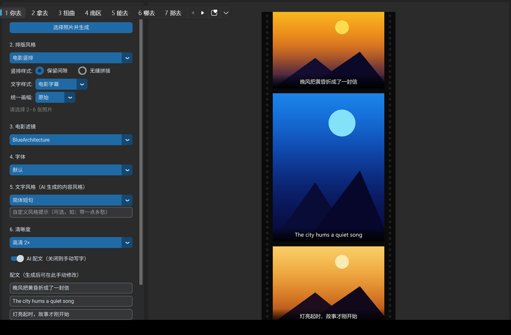

# AI电影感拼图工具 (AI Cinematic Collage) V3.0

一个桌面应用程序，它结合多种照片布局、电影感滤镜和 AI 赋文功能，能将您的普通照片一键转化为富有故事性和艺术感的电影风格图片。



---

## 🌟 主要功能与特色 (Features)

*   **多种布局**
    *   **电影竖排**：黑色胶卷风格，两侧带齿孔，支持 **2–6 张**照片与「保留间隙 / 无缝拼接」两种子样式，还可统一裁切画幅（3:2 / 4:3 / 1:1）。
    *   **单张海报**：非对称「拍立得 / 画廊打印」风格，底部宽留白自动随文字长度扩展，文字垂直居中。
    *   **四宫格**：2×2 网格拼贴，照片自动居中裁切铺满格子。
*   **两种文字样式**：经典底部（白字黑描边贴照片下缘）/ 电影字幕（底部渐变遮罩 + 居中白字）。
*   **专业级滤镜引擎**：`luts/` 文件夹内的任意 `.cube` 3D LUT 均可使用（内置 3 个预设）。滤镜经缓存与提速优化，缺失或损坏时给出明确提示并跳过，不再静默吞错。
*   **AI 智能赋文**
    *   兼容任何 OpenAI 格式 API；一次请求发送全部照片（自动压缩以省 token），服务商不支持多图时自动降级。
    *   内置简体短句 / 繁体诗歌 / 英文散文风格，可追加自定义风格提示。
    *   AI 失败不再把报错文字画到照片上，而是提示后留空，可手动补写。
*   **文字可编辑、可重渲染**：生成后每张照片的文字都可手改；「重新渲染」换滤镜 / 字体 / 布局 / 清晰度时**不重复调用 AI**（省 token）。
*   **交互式预览**：滚轮以鼠标为中心缩放、左键拖动、双击适应窗口；缩放先快速预览、停手后高质量重绘。
*   **三档清晰度**：标准 1× / 高清 2×（默认，胶卷约 1440px 宽、海报约 1800px 宽）/ 超清 3×。
*   **健壮性**：EXIF 方向自动转正、透明/CMYK 统一转 RGB 铺白底、超大图自动限尺寸；不配置 `.env` 也可在纯手动模式下使用（写文字 → 重新渲染）。
*   **现代化架构**：`config / imaging / filters / layouts / textdraw / pipeline / ai_connector / app_ui` 职责单一，核心逻辑与界面解耦，pytest 覆盖（含 LUT 与 colour-science 的对拍测试）。
*   **设置记忆**：布局 / 滤镜 / 字体 / 文字风格 / 清晰度 / 上次保存目录自动记入 `settings.json`，日志写入滚动的 `app.log`（绝不记录 API Key）。

---

## 🚀 安装与运行 (Installation & Usage)

### 1. 准备环境 (Prerequisites)
*   实测环境为 **Python 3.12**（Windows）；3.9+ 理论可用。
*   建议在虚拟环境中运行。

### 2. 安装依赖
`luts/`、`fonts/` 已随仓库附带，**无需手动创建**；想加滤镜 / 字体，直接往文件夹里放 `.cube` / `.ttf` 文件即可，程序启动时自动识别。

```bash
git clone <本仓库>
cd PhotoMagic
python -m venv .venv
.venv\Scripts\activate        # Windows；macOS/Linux 用 source .venv/bin/activate
pip install -r requirements.txt
```

### 3. 配置 AI（可选）
1.  复制 `.env.example` 重命名为 `.env`。
2.  填入服务商提供的信息：
    ```env
    OPENAI_API_KEY="您的API密钥"
    OPENAI_API_BASE="您的API服务器地址"
    # 可选：模型名（必须是支持图片的视觉模型）、超时、max_tokens
    #OPENAI_MODEL="stepfun-ai/step3"
    ```
> **安全提示**：`.gitignore` 已忽略 `.env`，密钥不会进仓库。**未配置 AI 也能用**：关闭「AI 配文」开关，手动写字后点「重新渲染」即可。

### 4. 运行
```bash
python main.py
```

---

## 📂 项目结构 (Project Structure)

```
PhotoMagic/
├── fonts/                # 自定义字体 (.ttf/.otf/.ttc)，自动识别
├── luts/                 # 滤镜文件 (.cube)，自动识别
├── samples/              # make_samples.py 生成的样图（不入库）
├── tests/                # pytest 测试（全部离线，AI 均为 mock）
├── tools/                # make_samples.py 样图工具 / ui_selftest.py 界面自检
├── ai_connector.py       # AI 调用与结果解析（AiError 中文异常）
├── app_ui.py             # 界面与调度（线程安全，不含图像逻辑）
├── config.py             # 路径、.env、settings.json、日志
├── filters.py            # LUT 解析缓存 + numpy 三线性插值应用
├── imaging.py            # 读图规范化（EXIF/RGB/限尺寸）与裁切缩放
├── layouts.py            # 布局渲染（Slot/RenderResult/Layout 注册表）
├── pipeline.py           # 生成流程（不依赖 Tk，UI 与测试共用）
├── textdraw.py           # 字体解析回退、中英混排换行、自适应字号
├── main.py               # 程序入口（支持 --smoke-test）
├── .env.example          # 环境变量模板
├── requirements.txt      # 运行依赖
├── requirements-dev.txt  # 开发依赖（pytest）
├── build_exe.md          # PyInstaller 打包说明（未验证）
├── REFACTOR_LOG.md       # v3 重构日志（含各阶段决策与验收记录）
└── REFACTOR_PLAN.md      # v3 重构方案原文
```

---

## 🧪 开发与测试

```bash
pip install -r requirements-dev.txt
python -m pytest              # 全量测试（74+ 用例，离线运行）
python main.py --smoke-test   # 冒烟测试：建窗 1 秒后自动退出，退出码 0 即通过
python tools/make_samples.py  # 生成各布局样图到 samples/
python tools/ui_selftest.py   # 程序化界面自检（需桌面环境）
```

---

## 🔧 未来可扩展方向 (Future Development)
*   在 `layouts.py` 的注册表里注册新布局（实现 `Layout` 接口即可，UI 自动出现选项）。
*   在 `ai_connector.STYLE_PROMPTS` 里增加新的文字风格预设。
*   打包为免安装可执行文件（见 `build_exe.md`）。

---
*项目作者：https://github.com/woyaoxingfua 。*
